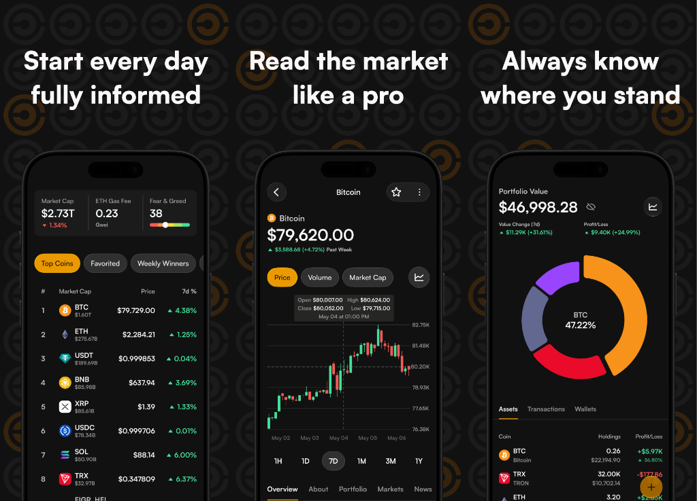

<p align="center">
  
</p>

<p align="center">
  A private crypto tracker for iOS, Apple Watch, and Android.<br>
  Follow markets and a personal portfolio without an account, ads, or sign-up.
</p>

<p align="center">
  <a href="https://apps.apple.com/app/coincurrently/id1543974454"></a>
  &nbsp;&nbsp;&nbsp;
  <a href="https://play.google.com/store/apps/details?id=com.cryptium.coincurrently"></a>
  <br>
  <a href="https://github.com/orre1996/CoinCurrentlyAndroid">Android repo</a>
  &nbsp;·&nbsp;
  <a href="https://coincurrently.app">Website</a>
</p>

<p align="center">
  <a href="https://github.com/orre1996/CoinCurrently-iOS/actions/workflows/tests.yml"></a>
</p>

<p align="center">
  
</p>

The iOS app lives in `CryptoTracker`. Watch and widget extensions reuse the same domain types and repositories where they need shared data.

## What it does

- Markets — coins, NFTs, exchanges, derivatives, and categories
- Personal portfolio
- Price alerts
- Home Screen and Lock Screen widgets
- Apple Watch

## Why this is open source

CoinCurrently is focused on privacy. The source is public so anyone can see what the app does with their data. The license is source-available, not OSI open source — see [License](#license).

## Privacy

CoinCurrently does not ask for an email or password. Portfolio holdings, transactions, and settings stay on the device.

The app uses a few third-party SDKs. None of them require a name, email, or phone number, so there is still no personal account.

- **[Aptabase](https://aptabase.com)** is a privacy-focused analytics service. The app sends named product events (for example which screen opened). It is not an advertising SDK and does not build a marketing profile.
- **[Firebase](https://firebase.google.com)** starts only when `GoogleService-Info.plist` is included. It signs in anonymously — a random ID on the device, not an email. Price alerts need that so Firebase Cloud Messaging can issue an FCM token. The backend uses the token to send a push when a price hits; without it, the phone cannot receive alert notifications.

See the [Privacy Policy](https://coincurrently.app/privacy).

## Architecture

The app uses **MVVM + repositories**.

- A **repository** is the source of truth for a slice of data (toplist, portfolio, and so on). It fetches from the network, caches, and persists. Screens do not talk to the API directly.
- A **view model** reads from one or more repositories, then shapes that data for a specific screen: filtering, sorting, hover state, loading flags, and user actions.
- A **view** (SwiftUI screen) renders the view model and sends user events back. It should not own cache or networking.

```
View  →  ViewModel  →  Repository  →  NetworkManager / Settings / Core Data
              ↑               │
              └──── cached / mapped data
```

### Repositories

Repositories are Swift `actor`s, usually behind a protocol plus an `*Imp` implementation (`ToplistRepository` / `ToplistRepositoryImp`). Production code uses a shared instance; tests inject a mock `NetworkManager`.

A repository is responsible for:

- Loading and refreshing a domain (for example `getSmallToplist()`)
- Holding the cached copy of that data
- Writing user or session state that belongs to that domain (saved coins, portfolio transactions)
- Talking to `NetworkManager`, `SettingsManager`, and Core Data — not to SwiftUI

Several screens can share the same repository. Home, Market, and Coin Detail all read coin prices from the same source instead of each keeping their own list.

### View models

View models are `@MainActor` and typically `@Observable`. They:

- Ask repositories for data
- Keep screen-only state (selected tab, hover point, empty/loading)
- Map repository models into what the view needs (a short home carousel vs a full market list, formatted P&L)
- Handle user actions, then write back through the repository when the change should be shared

They do not persist the app-wide cache. If Home and Market both show coins, the repository cache is what they share; each view model only keeps the slice its screen displays.

### Views

SwiftUI screens own a view model (`@State private var viewModel = HomeViewModelImp()`), observe it, and call `async` methods from `Task`s. Shared chrome (charts, list rows, sheets) lives in `SharedUI` so features stay focused on their own flow.

### Example: Home

1. `ToplistRepository` fetches and caches the coin list.
2. `HomeViewModel` loads that cache and keeps the slice for the selected carousel.
3. `HomeScreen` binds to that list and asks the view model to refresh when the user changes filter.

## File structure

```
CryptoTracker/
  App/                 Entry point, tabs, navigation, Siri, deeplinks
  Core/                Shared infrastructure (not feature UI)
    Analytics/
    Config/            AppSecrets reader (values stay in gitignored Secrets.plist)
    Domain/            Shared models (Toplist, CurrencyDataModel, …)
    Networking/        Endpoint, NetworkManager
    Persistence/       Core Data, local storage
    Purchases/
    Settings/
    Utilities/
  SharedUI/            Reusable views, charts, modifiers, sheets
  Features/            One folder per product area
    Home/
    Market/            Toplist, Heatmap, NFTs, Exchanges, Derivatives, Categories
    CoinDetail/
    Portfolio/
    …

CoinCurrentlyTests/    Mirrors Core/ and Features/
CryptoWidget/          Home Screen and Lock Screen widgets
CoinCurrentlyWatch Extension/
```

A typical feature looks like:

```
Features/Home/
  Screens/             HomeScreen
  ViewModels/          HomeViewModel
  Models/
  Views/
```

Smaller features may keep a few files at the feature root. Shared types used by many features belong in `Core/Domain` or `SharedUI`, not in the first feature that happened to need them.

## Networking

Market data and the fear and greed index each come from a different API. `NetworkManager` and `Endpoint` in `Core/Networking` own the requests; screens never call these APIs directly.

### CoinGecko

Crypto market data is based on [CoinGecko's API](https://www.coingecko.com/en/api).

If `Secrets.plist` is missing, or `API_BASE_URL` is empty or still `https://api.example.com`, market routes call CoinGecko's [keyless public API](https://docs.coingecko.com/docs/keyless-public-api) at `https://api.coingecko.com/api/v3`. No API key and no `/crypto` prefix. That is enough to open the project and load toplists, search, coin detail, OHLC, and market charts. The keyless API is shared and limited to about 5 calls per minute, so refreshing several screens in a row can return HTTP 429. It is for local development, not production.

Set `API_BASE_URL` to your own backend to proxy markets as `{API_BASE_URL}/crypto/api/v3/...`. CoinGecko's public host does not serve the `/crypto` prefix, so `https://api.coingecko.com` cannot be used as `API_BASE_URL`.

On a keyed Demo or Basic plan, most market routes work. These require the [Analyst plan](https://www.coingecko.com/en/api/pricing) (or higher), and they also fail on the keyless API:

- `/coins/list/new` — recently listed coins
- `/coins/top_gainers_losers` — top gainers and losers
- `/global/market_cap_chart` — historical global market cap and volume
- `/nfts/markets` — NFT collection market data
- `/nfts/{id}/market_chart` — NFT floor price, market cap, and volume history
- `/nfts/{id}/tickers` — NFT floor price and volume per marketplace
- CGSimplePrice WebSocket — live coin prices

### Fear and Greed

The fear and greed index is requested directly from [alternative.me](https://alternative.me/crypto/fear-and-greed-index/). It does not use `API_BASE_URL`.

### CoinCurrently backend

The backend is not in this repo. It proxies CoinGecko so third-party keys stay off the client, and it hosts first-party routes for price alerts, big-mover notifications, wallet import, gas fees, user, and feedback. Those first-party routes send a bearer token.

Without that backend, markets still load from the keyless CoinGecko API, and the fear and greed index still loads from alternative.me. Price alerts, big-mover notifications, wallet import, gas fees, user, and feedback stay empty until `API_BASE_URL` points at a backend.

## Targets

| Target | Role |
| --- | --- |
| CoinCurrently | iOS app (`CryptoTracker`) |
| CryptoWidgetExtension | Widgets |
| CoinCurrentlyWatch | watchOS app |
| CoinCurrentlyTests | Swift Testing suites, mostly repositories |

`CryptoTracker` is a synchronized Xcode group, so new files under that folder join the iOS target automatically. Watch and widget still compile shared Swift files through explicit project references.

## Requirements

- iOS 18 and watchOS 10
- Xcode 16 or later

## Local setup

1. Open `CoinCurrently.xcodeproj` and run the **Cryptocurrently** scheme. The target is CoinCurrently. The first build downloads Swift packages from GitHub, so it needs a network connection. YouTubePlayerKit is already in the repo.
2. Set your own Development Team on the CoinCurrently, CryptoWidgetExtension, and CoinCurrentlyWatch targets. Running the iOS app signs the widget and watch targets too. Leave `DEVELOPMENT_TEAM` empty in committed project files. Do not commit a team ID, bundle ID change, or real keys.

   The committed bundle IDs are `Cryptium.Cryptocurrently1`, `Cryptium.Cryptocurrently1.Cryptowidget`, and `Cryptium.Cryptocurrently1.watchkitapp`. Another Apple team has to change all three together and keep the widget and watch IDs as suffixes of the app ID.

   Automatic signing also needs these identifiers on that team. Change them together with the bundle IDs when the team does not own them:

   - App Group `group.com.Cryptium.CoinCurrently` on the app, widget, and watch
   - iCloud container `iCloud.com.Cryptium.CoinCurrently` and CloudKit on the app and widget
   - Push notifications (`aps-environment` is `production`)
   - Associated Domains `applinks:coincurrently.app`
   - App Attest

   A free personal team cannot enable push, associated domains, or iCloud.
3. `Config/Secrets.plist` is optional and gitignored. With no file, or with the example placeholders, the app calls CoinGecko's keyless API and skips analytics. Copy `Config/Secrets.example.plist` to `Config/Secrets.plist` when you have a backend or an Aptabase key:
   - `API_BASE_URL` — your backend, with no trailing slash. Leave `https://api.example.com` to keep the keyless CoinGecko API. A real URL proxies markets through `{API_BASE_URL}/crypto/api/v3/...` and enables the first-party routes above.
   - `BACKEND_API_KEY` — sent as `x-coin-currently-key` when it is not the example placeholder. The keyless CoinGecko calls do not send it.
   - `APTABASE_APP_KEY` — analytics stay off while this is empty or `A-XX-0000000000`.
4. When `Config/Secrets.plist` exists, the CoinCurrently, CryptoWidgetExtension, and CoinCurrentlyWatch targets copy it into the bundle. Widgets and Watch read the same file.
5. Firebase, anonymous sign-in, and price-alert push stay off until a real `GoogleService-Info.plist` is in the bundle. The app launches without that file. `GOOGLE_APP_ID` has to look like `1:<digits>:ios:<hex>`. The placeholders in `Config/GoogleService-Info.example.plist` do not match that, so copying the example file does not turn Firebase on. Put a real plist at `CryptoTracker/GoogleService-Info.plist` for the app and `CryptoWidget/GoogleService-Info.plist` for widgets. Those files are gitignored. The watch app does not use Firebase.

## Tests

`CoinCurrentlyTests` uses Swift Testing. Suites mostly cover repositories and inject a mock `NetworkManager`. Run the **CoinCurrentlyTests** scheme in Xcode.

GitHub runs that scheme on every push to `main` and every pull request. The [tests badge](https://github.com/orre1996/CoinCurrently-iOS/actions/workflows/tests.yml) shows the latest push to `main`: **passing** after a successful run, **failing** after a failed one. On a commit or pull request, the same result is the check mark next to the commit. Open the run and the **Run tests** step for the log. A failed run also uploads `TestResults.xcresult`.

## Contributing

Pull requests are welcome. Match the existing MVVM + repository layout. Do not commit secrets, signing material, a team ID, or a live Firebase config. Keep `DEVELOPMENT_TEAM` empty in the project file.

## License

This repository is source-available under the [CoinCurrently Source-Available License](LICENSE). You may view, study, and use it for personal and educational purposes, and contributions are welcome. You may not republish it, ship a public fork, or publish a derived app to an app store.
